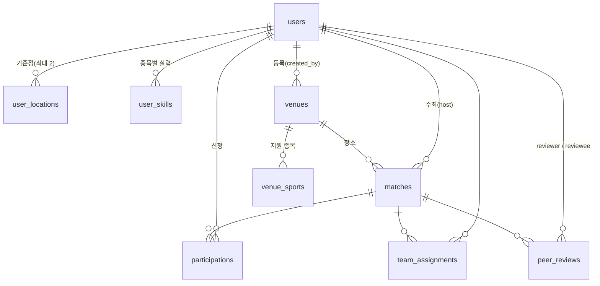

# DB 스키마

모든 종목이 **테이블 하나를 같이 쓴다.** 종목은 `sport` 컬럼(`basketball` / `football` / `badminton`)으로 구분한다.
모델은 `backend/app/models/`, 마이그레이션은 `backend/migrations/versions/`.

## 변경 규칙
- 테이블·컬럼 변경은 **코어 PR**로만 올린다 (종목 담당자는 `sport` 값과 `app/sports/<종목>/` 코드로 해결).
- 변경하면 이 문서의 ERD도 함께 고친다.
- `uv run alembic revision --autogenerate` 후 생성 파일을 반드시 열어 검토하고, `uv run alembic check`로 모델과 일치하는지 확인한다.

## ERD

## 테이블
| 테이블 | 핵심 컬럼 | 제약·인덱스 |
|---|---|---|
| `users` | email, password, nickname, gender, birth_year, role, manner_score, games_played, no_show_count, is_active, deleted_at | email·nickname 유니크 |
| `user_locations` | user_id, slot(1~2), label, point, max_distance_km | (user_id, slot) 유니크 → 최대 2개, SPATIAL INDEX(point) |
| `user_skills` | user_id, sport, self_tier(1~5), years_played, rating, rd, volatility, trend, games_rated, positions(JSON) | (user_id, sport) 유니크 |
| `venues` | name, address, point, created_by, is_active | SPATIAL INDEX(point) |
| `venue_sports` | venue_id, sport | PK (venue_id, sport) |
| `matches` | sport, host_id, venue_id, title, description, starts_at, duration_min, team_size, capacity, min_players, gender_policy, tier_min, tier_max, status | tier_min ≤ tier_max, 인덱스 (sport, status, starts_at) |
| `participations` | match_id, user_id, status, position | (match_id, user_id) 유니크 → 중복 신청 방지 |
| `team_assignments` | match_id, user_id, team_no, position, is_manual | (match_id, user_id) 유니크 |
| `peer_reviews` | match_id, reviewer_id, reviewee_id, verdict, manner_flag | (match_id, reviewer, reviewee) 유니크. 탈퇴 시 id를 NULL로 바꿔 익명 보존 |
| `matching_weights` | name, w_dist, w_skill, w_time, w_host, w_fill, is_active | name 유니크. 기본값 `default` 행이 마이그레이션에 포함됨 |

## 알아둘 점
- **좌표**: `GeoPoint` 타입, 파이썬에서는 `(lng, lat)` 튜플 (경도가 먼저). SRID 4326은 DB가 강제하지 않는다. ORM 저장은 항상 4326으로 들어가고, raw SQL도 4326을 쓴다. 공간 raw SQL은 `repositories/`에만 둔다.
- **enum**: DB에는 VARCHAR로 저장한다 (값 추가가 쉽도록). 허용 값 검증은 Pydantic과 모델 enum이 한다.
- **sport 값**: DB는 검증하지 않는다. `app/sports/registry.py`에 등록된 id만 서비스에서 허용한다.
- **시각**: UTC로 저장한다.
- **서비스에서 검증할 것**: 자기 자신 평가 금지(MariaDB가 `ON DELETE SET NULL` 컬럼의 CHECK를 허용하지 않음), 같은 쌍 30일 내 1회 반영, 매치 인원이 종목 규칙(`SportRules`)에 맞는지, 가중치 합계.
- **rating/rd/volatility**는 서버 내부 값이다. 사용자에게 숫자로 노출하지 않는다.
- **탈퇴**: users는 행을 지우지 않고 개인정보만 지운다 (`is_active`, `deleted_at`). FK가 `RESTRICT`인 이유다.
- 로그인 토큰(refresh 회전·재사용 감지)용 테이블은 W3 인증 PR에서 추가한다.
